# ASIGNACIÓN 4 – AUDITORÍA Y HARDENING DE DISPOSITIVOS DE RED

**Instituto Tecnológico de Las Américas (ITLA)**  
**Asignatura:** Seguridad de Redes  
**Estudiante:** Merolyn Mejía Abreu  
**Matrícula:** 2025-0827  
**Entorno:** GNS3, Cisco IOS, FortiGate, Ubuntu y Python

---

## VIDEO DEMOSTRATIVO

https://youtu.be/mx2un4pa5FY

El video demuestra el funcionamiento de la topología, las configuraciones de seguridad, las auditorías automatizadas y la capacidad de remediación de los scripts.

---

## ÍNDICE

1. Introducción
2. Propósito y objetivos
3. Herramientas utilizadas
4. Topología y direccionamiento
5. Metodología de hardening
6. Hardening del router Cisco
7. Hardening del switch Cisco
8. Hardening del firewall FortiGate
9. Automatización de auditorías con Python
10. Remediación automática y verificación
11. Informes y scripts generados
12. Resultados generales
13. Estructura del repositorio
14. Observaciones y limitaciones
15. Conclusión

---

# 1. INTRODUCCIÓN

La seguridad de los dispositivos de red es fundamental para proteger la infraestructura tecnológica de una organización. 
Los routers, switches y firewalls permiten establecer comunicaciones y administrar el tráfico, pero una configuración inadecuada puede representar riesgos de seguridad.

En este laboratorio se implementó una infraestructura virtual mediante GNS3, integrada por un router Cisco, un switch Cisco, un firewall FortiGate y una máquina Ubuntu utilizada como estación de auditoría.

El trabajo consistió en seleccionar y aplicar medidas de hardening tomando como referencia recomendaciones de seguridad relacionadas con los CIS Benchmarks.

También se desarrollaron scripts en Python para automatizar la revisión de configuraciones, detectar incumplimientos, aplicar determinadas correcciones y generar informes de los resultados.

Finalmente, se realizaron pruebas de conectividad, verificaciones de seguridad, auditorías automatizadas y una prueba de remediación real para comprobar el funcionamiento del laboratorio.

---

# 2. PROPÓSITO Y OBJETIVOS

## 2.1. Propósito

Demostrar cómo se puede fortalecer la seguridad de una infraestructura de red mediante la aplicación de medidas de hardening y el uso de herramientas de automatización.

El laboratorio busca comprobar que es posible evaluar configuraciones, identificar incumplimientos, aplicar correcciones y generar evidencias de los resultados obtenidos.

## 2.2. Objetivo general

Implementar y verificar medidas de hardening en un router Cisco, un switch Cisco y un firewall FortiGate, utilizando GNS3 y scripts de auditoría desarrollados en Python.

## 2.3. Objetivos específicos

- Implementar una topología funcional con los tres dispositivos.
- Configurar el direccionamiento IP y comprobar la conectividad.
- Evaluar controles de seguridad seleccionados.
- Fortalecer la autenticación y administración remota.
- Deshabilitar servicios innecesarios.
- Desarrollar scripts de auditoría y remediación.
- Generar informes previos y posteriores.
- Demostrar una corrección real.
- Documentar las configuraciones y los resultados.

---

# 3. HERRAMIENTAS UTILIZADAS

| Herramienta | Función |
|---|---|
| GNS3 | Implementación de la topología virtual |
| Cisco IOS | Sistema operativo del router y switch |
| FortiGate VM | Firewall de la infraestructura |
| Ubuntu | Estación de auditoría |
| Python 3 | Desarrollo de scripts |
| Pexpect | Automatización de sesiones SSH |
| SSH | Administración remota |
| CIS Benchmarks | Referencia para seleccionar controles |
| GitHub | Publicación de documentación y evidencias |

---

# 4. TOPOLOGÍA Y DIRECCIONAMIENTO

## 4.1. Topología implementada

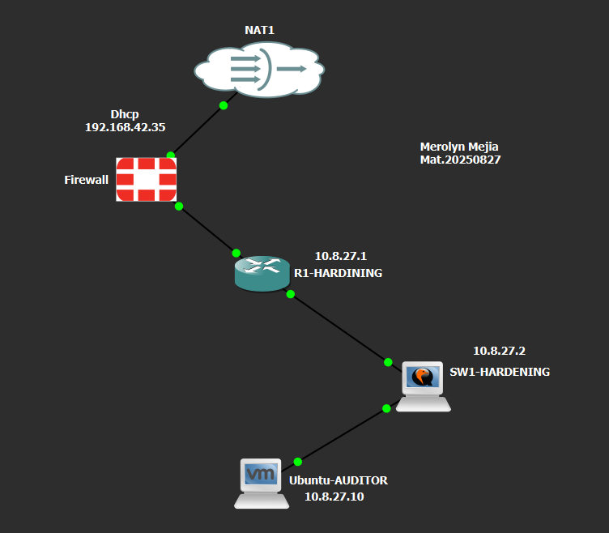

**Figura 1. Topología completa del laboratorio implementada en GNS3.**

En esta imagen se observa la infraestructura virtual utilizada durante el desarrollo de la práctica.

La topología contiene cinco elementos principales:

- **NAT1:** proporciona conectividad externa al laboratorio.
- **Firewall FortiGate:** se encuentra entre la red externa y el router Cisco.
- **R1-HARDINING:** router encargado de comunicar los segmentos de la infraestructura.
- **SW1-HARDENING:** switch utilizado para conectar la estación de auditoría.
- **Ubuntu-AUDITOR:** equipo desde el cual se ejecutan las pruebas y los scripts.

Los indicadores verdes visibles en GNS3 muestran que las conexiones representadas están activas.

La topología sigue el siguiente orden:

```text
               NAT1
                |
             FORTIGATE
                |
           R1-HARDINING
                |
           SW1-HARDENING
                |
           UBUNTU-AUDITOR
```

Esta estructura cumple con el requisito de implementar una infraestructura que contenga un router, un switch y un firewall.

## 4.2. Direccionamiento IP

| Dispositivo | Dirección IP | Función |
|---|---|---|
| FortiGate WAN | 192.168.42.35 | Conectividad hacia NAT1 |
| FortiGate LAN | 10.8.27.129 | Conexión hacia el router |
| Router Fa0/0 | 10.8.27.1 | Conexión hacia el switch |
| Router Fa1/0 | 10.8.27.130 | Conexión hacia FortiGate |
| Switch VLAN 1 | 10.8.27.2 | Administración del switch |
| Ubuntu-AUDITOR | 10.8.27.10 | Estación de auditoría |

El direccionamiento se organizó utilizando direcciones de la red `10.8.27.0`, relacionadas con los últimos dígitos de la matrícula.

## 4.3. Prueba de conectividad

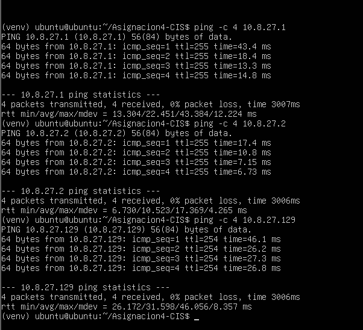

**Figura 2. Pruebas de conectividad realizadas desde Ubuntu.**

En esta captura se observa la ejecución de tres comandos `ping` desde la máquina Ubuntu-AUDITOR.

```bash
ping -c 4 10.8.27.1
ping -c 4 10.8.27.2
ping -c 4 10.8.27.129
```

La primera prueba corresponde al router, la segunda al switch y la tercera a FortiGate.

En los tres casos se enviaron cuatro paquetes y se recibieron cuatro respuestas.

Las estadísticas muestran `0% packet loss`, lo que indica que no hubo pérdida de paquetes durante estas pruebas.

**Resultado:** se confirmó la conectividad IP entre Ubuntu y los tres dispositivos que serían auditados.

Esta verificación es importante porque los scripts necesitan comunicarse con los equipos para consultar sus configuraciones mediante SSH.

---

# 5. METODOLOGÍA DE HARDENING

El hardening consiste en fortalecer la configuración de un sistema o dispositivo para reducir riesgos y limitar accesos o servicios innecesarios.

En esta práctica se seleccionaron controles relacionados con:

- Autenticación local.
- Administración remota mediante SSH.
- Restricción de protocolos de acceso.
- Tiempo de espera de sesiones.
- Bloqueo de intentos fallidos.
- Deshabilitación de servicios innecesarios.

La metodología aplicada fue:

1. Implementar la infraestructura en GNS3.
2. Configurar el direccionamiento IP.
3. Comprobar la conectividad.
4. Revisar las configuraciones de seguridad.
5. Evaluar los controles seleccionados.
6. Ejecutar auditorías automatizadas.
7. Aplicar correcciones cuando fuera necesario.
8. Realizar auditorías posteriores.
9. Guardar informes y evidencias.

Los scripts clasifican los controles utilizando dos estados:

**CUMPLE:** el dispositivo tiene el valor esperado.

**NO CUMPLE:** el parámetro no coincide con el criterio establecido y requiere revisión o corrección.

Esta evaluación se limita a los controles seleccionados y no representa una certificación integral de cumplimiento CIS.

---

# 6. HARDENING DEL ROUTER CISCO

## 6.1. Configuración y verificación de seguridad

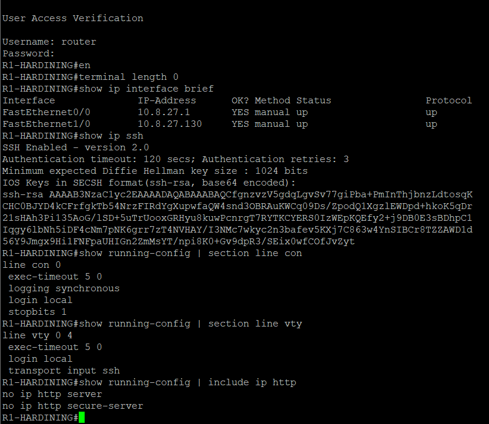

**Figura 3. Verificación de las configuraciones de seguridad del router R1-HARDINING.**

En esta captura se observa la consola del router Cisco y la ejecución de diferentes comandos utilizados para comprobar sus configuraciones.

### Verificación de interfaces

Se ejecutó:

```cisco
show ip interface brief
```

El resultado muestra dos interfaces activas:

| Interfaz | Dirección IP | Estado |
|---|---|---|
| FastEthernet0/0 | 10.8.27.1 | up/up |
| FastEthernet1/0 | 10.8.27.130 | up/up |

Esto confirma que las interfaces utilizadas en la topología están habilitadas y operativas.

### Verificación de SSH

Se ejecutó:

```cisco
show ip ssh
```

La salida muestra que SSH está habilitado en la versión 2.0.

SSH permite administrar el router mediante una conexión cifrada, reduciendo la exposición de las credenciales durante la administración remota.

### Seguridad de la consola

Se ejecutó:

```cisco
show running-config | section line con
```

El resultado muestra:

```cisco
line con 0
 exec-timeout 5 0
 logging synchronous
 login local
 stopbits 1
```

**`exec-timeout 5 0`:** establece un tiempo máximo de cinco minutos de inactividad.

**`login local`:** utiliza la base de usuarios locales para la autenticación.

También se verificó que la línea de consola no tuviera una asignación directa de `privilege level 15`.

### Seguridad del acceso remoto

Se ejecutó:

```cisco
show running-config | section line vty
```

La configuración encontrada fue:

```cisco
line vty 0 4
 exec-timeout 5 0
 login local
 transport input ssh
```

Esto demuestra que las conexiones administrativas remotas utilizan SSH y autenticación local.

### Servicios web

También se comprobó:

```cisco
no ip http server
no ip http secure-server
```

Estos comandos indican que los servicios web de administración HTTP y HTTPS están deshabilitados.

## 6.2. Justificación del hardening

Las medidas aplicadas al router buscan:

- Evitar sesiones administrativas abiertas indefinidamente.
- Exigir autenticación para acceder al dispositivo.
- Restringir el acceso remoto a SSH.
- Evitar privilegios máximos asignados directamente a la consola.
- Reducir la exposición de servicios de administración innecesarios.

**Resultado:** se verificó que el router tiene aplicados los controles de seguridad seleccionados.

---

# 7. HARDENING DEL SWITCH CISCO

## 7.1. Configuración y verificación

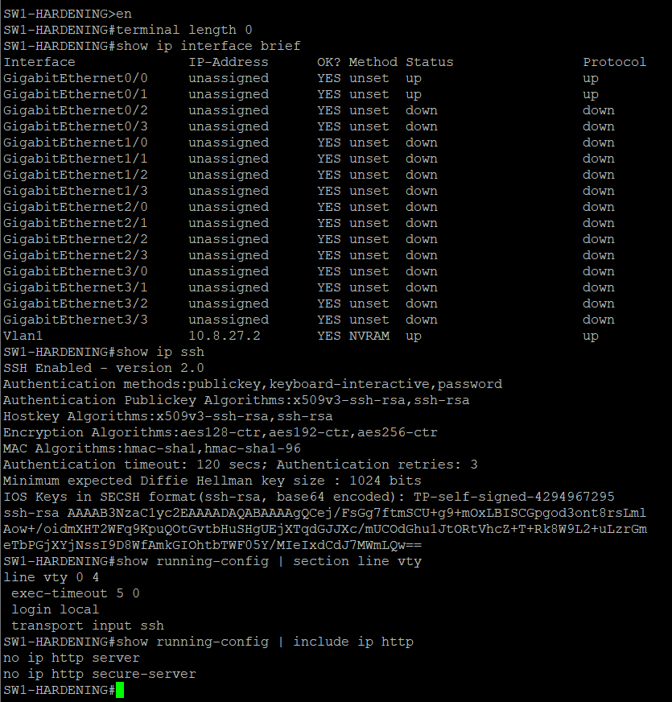

**Figura 4. Verificación de las configuraciones de seguridad del switch SW1-HARDENING.**

En esta imagen se observa la consola del switch Cisco y la ejecución de comandos para verificar sus controles de seguridad.

### Dirección IP de administración

Se ejecutó:

```cisco
show ip interface brief
```

El resultado muestra que la interfaz VLAN 1 tiene la dirección IP `10.8.27.2` y se encuentra activa.

Esta dirección permite administrar el switch desde la estación Ubuntu.

### SSH versión 2

Se ejecutó:

```cisco
show ip ssh
```

La salida confirma que SSH versión 2.0 está habilitado.

### Configuración VTY

Se ejecutó:

```cisco
show running-config | section line vty
```

El resultado muestra:

```cisco
line vty 0 4
 exec-timeout 5 0
 login local
 transport input ssh
```

Esta configuración establece autenticación local, restringe el acceso remoto a SSH y limita el tiempo de inactividad.

### Deshabilitación de servicios web

Se ejecutó:

```cisco
show running-config | include ip http
```

La salida muestra:

```cisco
no ip http server
no ip http secure-server
```

Esto confirma que HTTP y HTTPS están deshabilitados.

## 7.2. Controles seleccionados

| Control | Resultado esperado | Justificación |
|---|---|---|
| SSH versión 2 | Habilitado | Administración cifrada |
| Acceso remoto | Solo SSH | Restringir protocolos |
| Autenticación local | Habilitada | Controlar el acceso |
| Servidor HTTP | Deshabilitado | Reducir servicios innecesarios |
| Servidor HTTPS | Deshabilitado | Evitar administración web no utilizada |

**Resultado:** los cinco controles seleccionados se verificaron correctamente.

---

# 8. HARDENING DEL FIREWALL FORTIGATE

## 8.1. Configuración administrativa

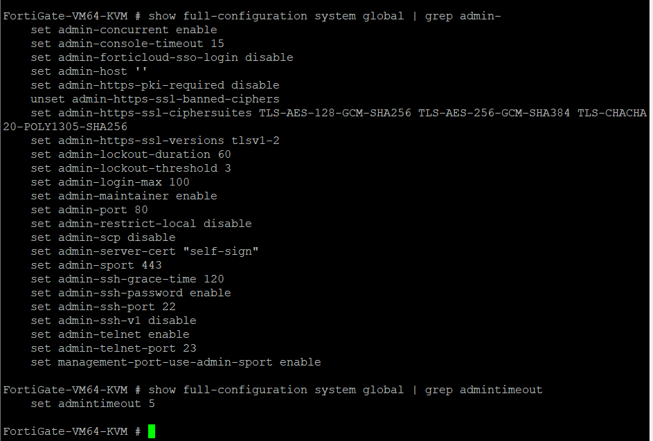

**Figura 5. Verificación de los parámetros de seguridad administrativa de FortiGate.**

En esta captura se observa la consola del firewall FortiGate y la consulta de su configuración global.

Se ejecutó:

```text
show full-configuration system global | grep admin-
```

El resultado muestra los siguientes parámetros:

```text
set admin-console-timeout 15
set admin-lockout-duration 60
set admin-lockout-threshold 3
set admin-ssh-v1 disable
```

También se ejecutó:

```text
show full-configuration system global | grep admintimeout
```

El resultado fue:

```text
set admintimeout 5
```

## 8.2. Explicación de los controles

| Parámetro | Valor | Propósito |
|---|---|---|
| `admintimeout` | 5 | Cerrar sesiones administrativas inactivas |
| `admin-ssh-v1` | disable | Deshabilitar SSH versión 1 |
| `admin-lockout-threshold` | 3 | Establecer un límite de intentos fallidos |
| `admin-lockout-duration` | 60 | Aplicar un bloqueo temporal |
| `admin-console-timeout` | 15 | Limitar la inactividad de la consola |

### Particularidad encontrada

Durante el laboratorio se intentó establecer un tiempo de espera de consola de cinco minutos.

Sin embargo, la versión de FortiGate utilizada no admitía ese valor.

Por esta razón se estableció el mínimo permitido de quince minutos:

```text
config system global
    set admin-console-timeout 15
end
```

Este ajuste permitió cumplir con el criterio definido para el laboratorio.

## 8.3. Auditoría complementaria de FortiGate

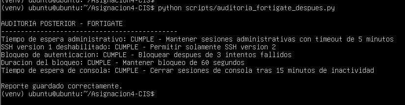

**Figura 6. Auditoría posterior de los cinco controles seleccionados de FortiGate.**

En esta captura se observa la ejecución del script:

```bash
python scripts/auditoria_fortigate_despues.py
```

El programa evaluó cinco controles utilizando la configuración posterior guardada.

Los resultados fueron:

```text
Tiempo de espera administrativo: CUMPLE
SSH version 1 deshabilitado: CUMPLE
Bloqueo de autenticacion: CUMPLE
Duracion del bloqueo: CUMPLE
Tiempo de espera de consola: CUMPLE
```

Cada resultado incluye una explicación breve sobre el propósito del control.

Esta auditoría complementaria permite revisar los cinco parámetros seleccionados, mientras que el script principal de hardening de FortiGate automatiza la verificación y posible corrección del tiempo de espera de consola.

**Resultado:** cinco controles administrativos verificados correctamente.

---

# 9. AUTOMATIZACIÓN DE AUDITORÍAS CON PYTHON

Para automatizar las verificaciones se desarrollaron scripts en Python que utilizan conexiones SSH para consultar las configuraciones de los dispositivos.

Los scripts principales son:

```text
scripts/hardening_router.py
scripts/hardening_switch.py
scripts/hardening_fortigate.py
```

## 9.1. Funcionamiento del modo 1

La primera opción permite realizar una auditoría sin modificar la configuración.

El procedimiento consiste en:

1. Solicitar las credenciales.
2. Establecer la conexión SSH.
3. Consultar la configuración.
4. Evaluar los controles seleccionados.
5. Mostrar los resultados.
6. Generar un informe.

## 9.2. Evidencia de auditorías automatizadas

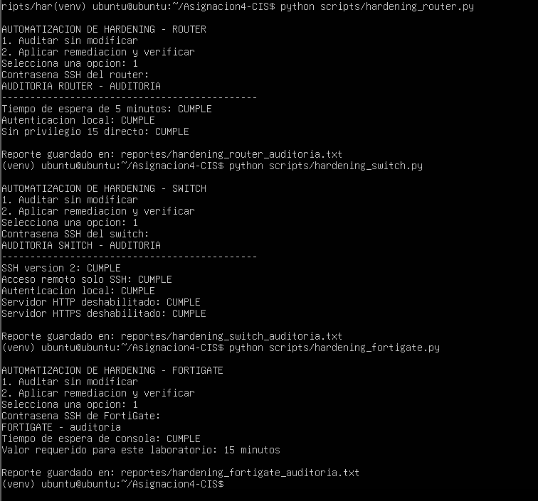

**Figura 7. Ejecución del modo 1 en los tres dispositivos.**

En esta captura se observa la ejecución de los tres scripts principales desde Ubuntu.

Se utilizaron los comandos:

```bash
python scripts/hardening_router.py
python scripts/hardening_switch.py
python scripts/hardening_fortigate.py
```

En los tres programas se seleccionó:

```text
1. Auditar sin modificar
```

### Router

Se verificaron tres controles:

```text
Tiempo de espera de 5 minutos: CUMPLE
Autenticacion local: CUMPLE
Sin privilegio 15 directo: CUMPLE
```

El informe generado fue:

`reportes/hardening_router_auditoria.txt`

### Switch

Se verificaron cinco controles:

```text
SSH version 2: CUMPLE
Acceso remoto solo SSH: CUMPLE
Autenticacion local: CUMPLE
Servidor HTTP deshabilitado: CUMPLE
Servidor HTTPS deshabilitado: CUMPLE
```

El informe generado fue:

`reportes/hardening_switch_auditoria.txt`

### FortiGate

El script principal verificó:

```text
Tiempo de espera de consola: CUMPLE
```

El informe generado fue:

`reportes/hardening_fortigate_auditoria.txt`

### Interpretación

La imagen demuestra que los tres programas pueden ejecutarse desde Ubuntu y generar resultados de auditoría.

También demuestra el funcionamiento de la opción 1, que no aplica modificaciones a los dispositivos.

**Resultado:** auditorías automatizadas completadas correctamente.

---

# 10. REMEDIACIÓN AUTOMÁTICA Y VERIFICACIÓN

La segunda opción de los scripts permite realizar una auditoría previa, aplicar las correcciones contempladas cuando sean necesarias y generar una auditoría posterior.

## 10.1. Ejecución del modo 2 en el switch

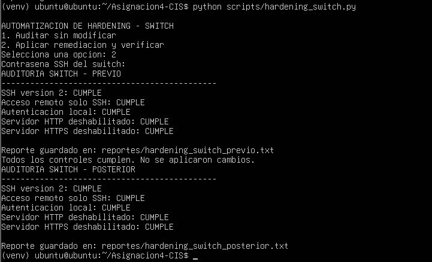

**Figura 8. Ejecución del modo 2 en SW1-HARDENING.**

En esta captura se ejecuta:

```bash
python scripts/hardening_switch.py
```

Se selecciona:

```text
2. Aplicar remediacion y verificar
```

El programa realiza una auditoría previa y muestra que los cinco controles cumplen.

Por esta razón indica:

```text
Todos los controles cumplen. No se aplicaron cambios.
```

Posteriormente ejecuta la auditoría final y genera:

```text
reportes/hardening_switch_previo.txt
reportes/hardening_switch_posterior.txt
```

Esto demuestra que el programa puede ejecutar el modo 2 sin modificar innecesariamente una configuración que ya cumple.

## 10.2. Demostración de una corrección real

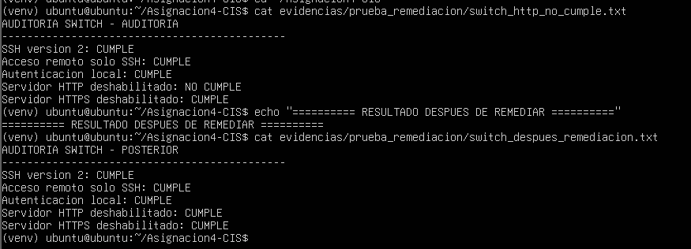

**Figura 9. Comparación del estado del servidor HTTP antes y después de la corrección.**

Esta prueba demuestra un cambio real en uno de los controles del switch.

Para realizarla, anteriormente se habilitó temporalmente el servidor HTTP dentro del entorno controlado de GNS3.

Después se ejecutó la auditoría y el programa identificó el incumplimiento.

### Estado anterior

En la primera parte de la captura se consulta:

```bash
cat evidencias/prueba_remediacion/switch_http_no_cumple.txt
```

El resultado muestra:

```text
SSH version 2: CUMPLE
Acceso remoto solo SSH: CUMPLE
Autenticacion local: CUMPLE
Servidor HTTP deshabilitado: NO CUMPLE
Servidor HTTPS deshabilitado: CUMPLE
```

El servidor HTTP aparece como `NO CUMPLE` porque estaba habilitado.

### Estado posterior

En la segunda parte se consulta:

```bash
cat evidencias/prueba_remediacion/switch_despues_remediacion.txt
```

El resultado muestra:

```text
SSH version 2: CUMPLE
Acceso remoto solo SSH: CUMPLE
Autenticacion local: CUMPLE
Servidor HTTP deshabilitado: CUMPLE
Servidor HTTPS deshabilitado: CUMPLE
```

### Comparación

| Control | Antes | Después |
|---|---|---|
| SSH versión 2 | CUMPLE | CUMPLE |
| Acceso remoto solo SSH | CUMPLE | CUMPLE |
| Autenticación local | CUMPLE | CUMPLE |
| **Servidor HTTP deshabilitado** | **NO CUMPLE** | **CUMPLE** |
| Servidor HTTPS deshabilitado | CUMPLE | CUMPLE |

Esta comparación demuestra que el incumplimiento HTTP quedó corregido.

La captura muestra los informes guardados; el código del script y la demostración en video complementan la explicación del procedimiento de remediación.

**Resultado:** corrección del incumplimiento HTTP verificada mediante auditoría posterior.

## 10.3. Ejecución del modo 2 en router y FortiGate

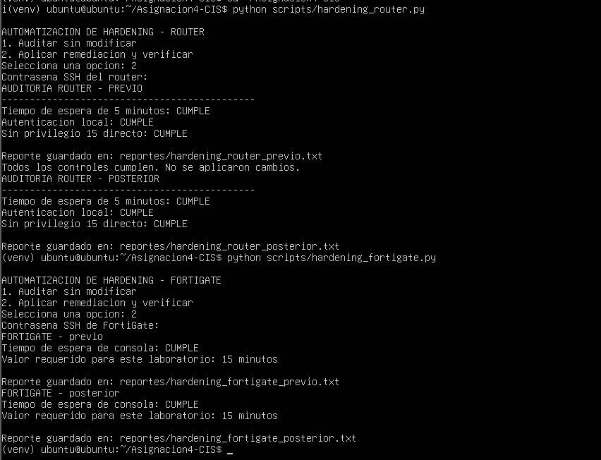

**Figura 10. Ejecución de la opción 2 en el router y FortiGate.**

En esta captura se observa la ejecución de los scripts:

```bash
python scripts/hardening_router.py
python scripts/hardening_fortigate.py
```

En ambos casos se seleccionó la opción 2.

### Router

El programa realizó una auditoría previa de tres controles:

- Tiempo de espera de cinco minutos.
- Autenticación local.
- Ausencia de privilegio 15 directo.

Los tres controles aparecieron como `CUMPLE`.

El programa indicó que no era necesario aplicar cambios.

Después realizó una auditoría posterior y guardó:

```text
reportes/hardening_router_previo.txt
reportes/hardening_router_posterior.txt
```

### FortiGate

El programa evaluó el tiempo de espera de consola.

El resultado fue:

```text
Tiempo de espera de consola: CUMPLE
Valor requerido para este laboratorio: 15 minutos
```

Después generó:

```text
reportes/hardening_fortigate_previo.txt
reportes/hardening_fortigate_posterior.txt
```

### Interpretación

La evidencia demuestra que los scripts del router y FortiGate permiten ejecutar el modo 2 y generar los informes correspondientes.

En estas ejecuciones no fue necesario aplicar modificaciones porque los controles evaluados ya cumplían.

**Resultado:** modo de remediación y verificación ejecutado correctamente en los tres dispositivos.

---

# 11. INFORMES Y SCRIPTS GENERADOS

## 11.1. Informes de auditoría

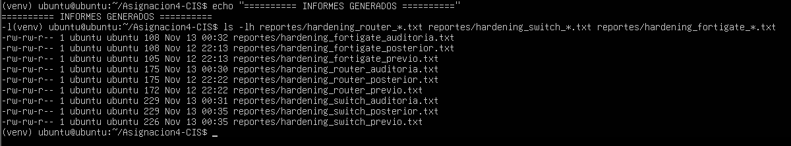

**Figura 11. Listado de informes generados por los scripts.**

En esta captura se ejecuta:

```bash
ls -lh reportes/hardening_router_*.txt reportes/hardening_switch_*.txt reportes/hardening_fortigate_*.txt
```

El resultado muestra nueve informes principales.

Cada dispositivo cuenta con:

- Informe de auditoría.
- Informe previo.
- Informe posterior.

| Dispositivo | Auditoría | Previo | Posterior |
|---|---|---|---|
| Router | Generado | Generado | Generado |
| Switch | Generado | Generado | Generado |
| FortiGate | Generado | Generado | Generado |

Esta evidencia demuestra que los scripts guardan los resultados en archivos que pueden revisarse posteriormente.

## 11.2. Scripts del laboratorio

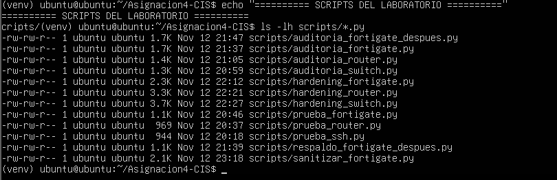

**Figura 12. Archivos Python utilizados durante el laboratorio.**

En esta captura se ejecuta:

```bash
ls -lh scripts/*.py
```

El resultado muestra once archivos Python.

Entre ellos se encuentran:

- Scripts principales de hardening.
- Scripts complementarios de auditoría.
- Scripts auxiliares de conexión y verificación.
- Herramientas para preparar respaldos y configuraciones públicas.

Los tres scripts principales son:

```text
hardening_router.py
hardening_switch.py
hardening_fortigate.py
```

La captura demuestra que los archivos se encuentran guardados dentro del proyecto.

El código fuente publicado en el repositorio permite revisar las funciones implementadas.

---

# 12. RESULTADOS GENERALES

Los resultados finales de los controles seleccionados fueron:

| Dispositivo | Controles evaluados | Controles cumplidos |
|---|---:|---:|
| Router Cisco | 3 | 3 |
| Switch Cisco | 5 | 5 |
| FortiGate | 5 | 5 |
| **Total** | **13** | **13** |

## Porcentaje de cumplimiento

```text
Cumplimiento = (13 / 13) × 100
Cumplimiento = 100 %
```

Este resultado corresponde únicamente a los trece controles seleccionados para el laboratorio.

No representa una certificación integral de cumplimiento CIS.

## Resultados de la automatización

Se comprobó que:

- Los tres scripts principales ejecutan auditorías.
- Los tres permiten seleccionar el modo de remediación.
- Se generan informes previos y posteriores.
- Se documentó una corrección real del servicio HTTP en el switch.
- Los scripts identifican cuándo no es necesario aplicar cambios.

---

# 13. ESTRUCTURA DEL REPOSITORIO

```text
Asignacion4-CIS-Hardening/
|
|-- README.md
|
|-- Imagenes/
|   |-- image1.png
|   |-- image2.png
|   |-- image3.png
|   |-- image4.png
|   |-- image5.png
|   |-- image6.png
|   |-- image7.png
|   |-- image8.png
|   |-- image9.png
|   |-- image10.png
|   |-- image11.png
|   |-- image12.png
|
|-- scripts/
|   |-- hardening_router.py
|   |-- hardening_switch.py
|   |-- hardening_fortigate.py
|   |-- auditoria_router.py
|   |-- auditoria_switch.py
|   |-- auditoria_fortigate.py
|   |-- auditoria_fortigate_despues.py
|   |-- prueba_router.py
|   |-- prueba_fortigate.py
|   |-- prueba_ssh.py
|   |-- respaldo_fortigate_despues.py
|   |-- sanitizar_fortigate.py
|
|-- reportes/
|   |-- hardening_router_auditoria.txt
|   |-- hardening_router_previo.txt
|   |-- hardening_router_posterior.txt
|   |-- hardening_switch_auditoria.txt
|   |-- hardening_switch_previo.txt
|   |-- hardening_switch_posterior.txt
|   |-- hardening_fortigate_auditoria.txt
|   |-- hardening_fortigate_previo.txt
|   |-- hardening_fortigate_posterior.txt
|
|-- configuraciones_publicas/
|   |-- router_running_config.txt
|   |-- switch_running_config.txt
|   |-- fortigate_running_config_publica.txt
|
|-- evidencias/
|   |-- prueba_remediacion/
|       |-- switch_http_no_cumple.txt
|       |-- switch_antes_remediacion.txt
|       |-- switch_despues_remediacion.txt
```

Las running-configs deben publicarse únicamente después de revisar y ocultar contraseñas, hashes y claves privadas.

Los respaldos originales se conservan fuera del repositorio público.

---

# 14. OBSERVACIONES Y LIMITACIONES

## Compatibilidad de FortiGate

La versión utilizada no permitió configurar un tiempo de espera de consola de cinco minutos.

Se utilizó el mínimo admitido de quince minutos.

## Alcance de los scripts

El script principal de FortiGate automatiza la revisión y posible corrección del tiempo de espera de consola.

Los otros cuatro controles se evalúan mediante una auditoría complementaria.

## Corrección real

La remediación del servicio HTTP del switch fue documentada mediante informes anteriores y posteriores.

Las ejecuciones posteriores del modo 2 no necesitaron aplicar cambios adicionales.

## Alcance de CIS Benchmarks

El laboratorio utiliza controles seleccionados de hardening alineados con prácticas de configuración segura.

No se realizó una auditoría integral de todos los controles de una versión específica de CIS Benchmarks.

---

# 15. CONCLUSIÓN

Durante el desarrollo de esta práctica pude comprobar la importancia de mantener los dispositivos de red con configuraciones seguras. 
Mediante GNS3 implemente una infraestructura con un router, un switch y un firewall, 
sobre los cuales se realizaron verificaciones relacionadas con la autenticación, el acceso administrativo y los servicios habilitados.

Uno de los aspectos más importantes fue la automatización mediante Python, ya que permitió realizar auditorías, generar informes y comprobar el estado de los controles seleccionados. 
Además, mediante una prueba controlada en el switch, se demostró que el programa podía identificar una configuración insegura y aplicar una corrección.

En general, el laboratorio permitió fortalecer los conocimientos de seguridad de redes y comprender cómo las medidas de hardening y 
las herramientas de automatización ayudan a reducir riesgos y facilitar la administración de una infraestructura tecnológica.

---

**Asignación 4 – Auditoría y Hardening de Dispositivos de Red**  
**Merolyn Mejía Abreu – Matrícula 2025-0827**  
**Instituto Tecnológico de Las Américas (ITLA)**
